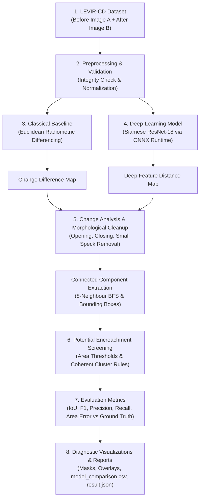

# Project Flow — Complete System Architecture & Pipeline

This document explains the end-to-end architecture of the **Satellite Land Use Change and Encroachment Detector** using plain, straightforward language suitable for a university viva demonstration.

---

## High-Level System Architecture

---

## Step-by-Step Flow Explanation

### 1. Dataset
* **Source Dataset:** LEVIR-CD (Large-scale Building Change Detection Benchmark).
* **Sample Structure:** Each sample consists of three synchronized rasters:
  1. **Before Image ($T_1$):** Optical RGB satellite/aerial raster prior to human development.
  2. **After Image ($T_2$):** Optical RGB satellite/aerial raster of the exact same geographic parcel taken years later.
  3. **Ground-Truth Mask:** Pixel-level binary mask ($1 = \text{building change}, 0 = \text{unchanged}$).
* **Tile Size:** Standardized to $256 \times 256$ pixels with 0.5 m/pixel Ground Sampling Distance (GSD).

---

### 2. Preprocessing
* **Integrity Validation (`ImageValidator.java`):**
  - Confirms file existence and image readability.
  - Verifies exact dimension matching ($W_A = W_B = W_{\text{label}}$, $H_A = H_B = H_{\text{label}}$).
  - Ensures correct color models (RGB optical imagery).
* **Normalization (`ImagePreprocessor.java` / `OnnxResNetChangeDetector.java`):**
  - Classical baseline normalizes RGB values to $[0.0, 255.0]$.
  - Deep-learning component normalizes RGB values using standard ImageNet mean $[0.485, 0.456, 0.406]$ and std $[0.229, 0.224, 0.225]$.

---

### 3. Classical Baseline (Pixel Difference)
* **Role:** Serves as the academic benchmark demonstrating the limitations of simple optical subtraction.
* **Algorithm (`DifferenceCalculator.java`):**
  Computes Euclidean RGB distance between Before and After pixels:
  $$\Delta(x, y) = \sqrt{(R_B - R_A)^2 + (G_B - G_A)^2 + (B_B - B_A)^2}$$
* **Thresholding (`ChangeMaskGenerator.java`):**
  Pixels with $\Delta \ge 35.0$ are marked as candidate changes.
* **Known Limitations:**
  Easily produces false alarms from seasonal sun-angle shifts, building shadows, clouds, and surface moisture variations.

---

### 4. Deep-Learning Component (Siamese ResNet-18)
* **Model File:** `models/onnx/resnet18_change_detector.onnx` (44.7 MB).
* **Runtime:** ONNX Runtime Java (`OrtSession` on CPU).
* **Architecture:**
  - Twin Siamese branch with pretrained ResNet-18 weights (He et al., CVPR 2016).
  - Both Before and After images pass through convolutional blocks up to `layer4` to extract 512-channel deep spatial feature maps ($8 \times 8$).
  - Computes spatial Euclidean distance across the 512 semantic feature channels.
  - Upsamples difference back to $256 \times 256$ via bilinear interpolation.
* **Why Deep Features Outperform Baseline:**
  ResNet convolutional kernels capture high-level semantic shapes (edges, corners, structural geometry). When sunlight changes, high-level features remain invariant; when a new building or warehouse is erected, high-level features change dramatically.

---

### 5. Change Detection & Noise Removal
* **Thresholding:** Converts continuous feature distances into a raw binary change mask.
* **Morphological Cleanup (`NoiseRemover.java`):**
  - **Opening (Erode $\rightarrow$ Dilate):** Eliminates isolated 1-pixel noise specks caused by sensor artifacts.
  - **Closing (Dilate $\rightarrow$ Erode):** Fills small internal gaps inside real building clusters.
  - **Area Filtering:** Discards residual clusters smaller than 30 pixels.
* **Connected Component Analysis (`ConnectedComponentAnalyzer.java`):**
  - Uses 8-neighbour Breadth-First Search (BFS) to segment individual change blobs.
  - Extracts bounding box coordinates $[x_{\min}, y_{\min}, w, h]$, pixel area, and centroid $[c_x, c_y]$.

---

### 6. Potential Encroachment Screening
* **Screening Engine (`EncroachmentDetector.java`):**
  Evaluates changed area percentage and region coherence against predefined rules:
  1. **POSSIBLE_ENCROACHMENT:** Total change $> 0.3\%$ of scene OR any single coherent cluster $\ge 150$ pixels.
  2. **POSSIBLE_CHANGE:** Minor changes ($0.1\% - 0.3\%$).
  3. **NO_SIGNIFICANT_CHANGE:** Change $< 0.1\%$ (negligible background fluctuation).
* **Operational Disclaimer:**
  Screening results indicate priority alert zones for field inspections and cadastral surveys. They do **not** constitute legal land-ownership adjudication.

---

### 7. Evaluation
* **Metrics Computed (`ChangeMetrics.java`):**
  - $\text{TP}$: Predicted change AND actual change.
  - $\text{FP}$: Predicted change BUT actual unchanged.
  - $\text{FN}$: Predicted unchanged BUT actual change.
  - $\text{TN}$: Predicted unchanged AND actual unchanged.
  - $\text{Precision} = \frac{TP}{TP + FP}$
  - $\text{Recall} = \frac{TP}{TP + FN}$ (Change Recall)
  - $\text{F1-Score} = \frac{2 \cdot TP}{2 \cdot TP + FP + FN}$
  - $\text{IoU} = \frac{TP}{TP + FP + FN}$
  - $\text{Area Error} = |\text{Predicted Changed Pixels} - \text{Ground Truth Changed Pixels}|$
  - $\text{Runtime}$ (in milliseconds).

---

### 8. Output & Deliverables
Every execution produces clean, reproducible outputs in `results/`:
* `before.png`: Input pre-period satellite raster.
* `after.png`: Input post-period satellite raster.
* `ground_truth.png`: Ground-truth binary change mask.
* `baseline_change_mask.png`: Classical pixel-difference change mask.
* `dl_predicted_mask.png`: Deep-learning Siamese ResNet-18 change mask.
* `highlighted_changes.png`: Annotated bounding boxes and IDs overlaid on After image.
* `comparison_image.png`: 5-panel diagnostic side-by-side comparison board.
* `metrics.csv`: Per-sample performance numbers.
* `model_comparison.csv`: Head-to-head empirical comparison table.
* `model_comparison_chart.png`: Rendered multi-metric comparison bar chart.
* `result.json`: Machine-readable audit payload.

